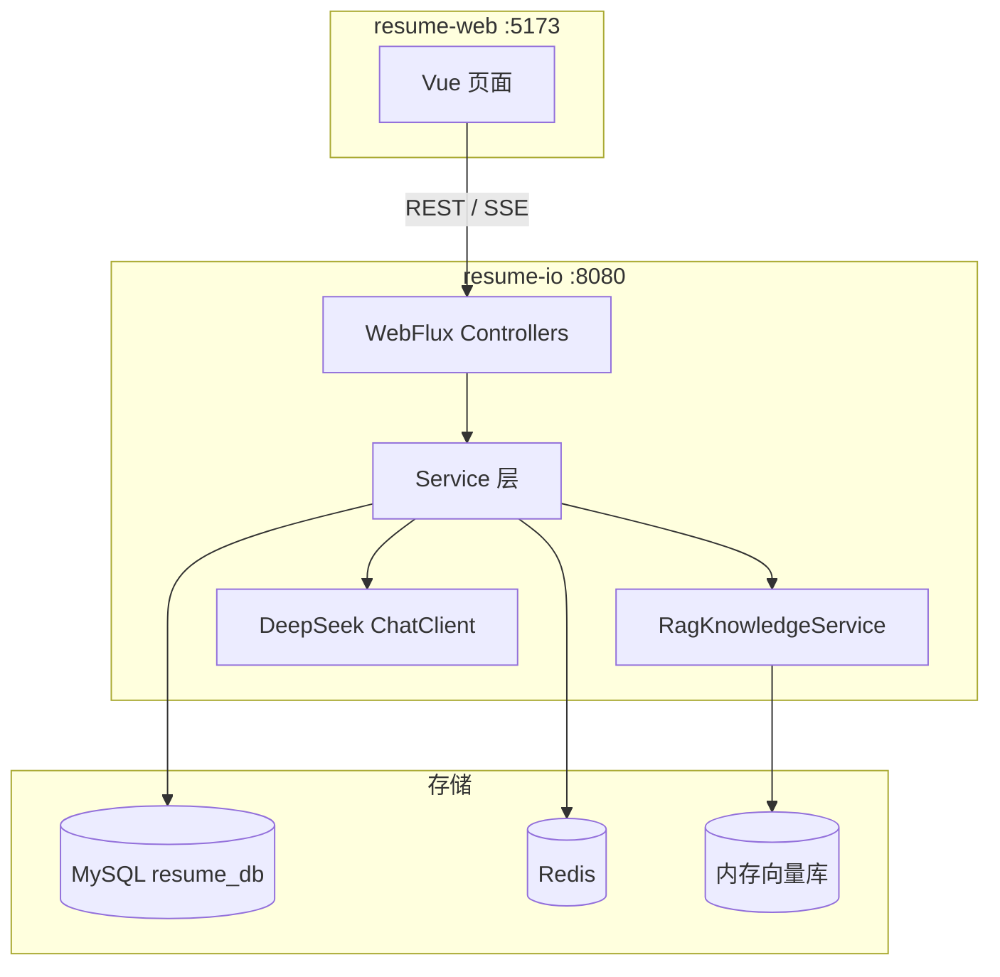

# Resume IO — AI 简历分析与模拟面试平台

基于 **Spring Boot + Vue 3** 的全栈项目，提供简历上传解析、AI 智能分析、RAG 增强对话、模拟面试等功能。

| 模块 | 目录 | 说明 |
|------|------|------|
| 后端 | [`resume-io/`](resume-io/) | Spring Boot 3.5 + WebFlux + JPA + JWT + Spring AI |
| 前端 | [`resume-web/`](resume-web/) | Vue 3 + Vite + Pinia + Element Plus |

---

## 功能概览

- **用户认证**：注册 / 登录（JWT），演示账号开箱即用
- **简历分析**：上传 PDF/Word 等文档，AI 生成评分与优化建议
- **分析报告**：雷达图维度评分、优劣势与改进方向
- **模拟面试**：基于简历与报告生成面试题，支持流式 AI 反馈
- **AI 对话**：RAG 检索增强，结合简历与知识库回答问题
- **个人中心**：敏感资料（姓名、手机、身份证等）Redis 存储 + API 脱敏展示
- **知识库**：上传文档入库，供 RAG 检索引用

---

## 技术栈

### 后端（resume-io）

| 类别 | 技术 |
|------|------|
| 框架 | Spring Boot 3.5.16、Spring WebFlux |
| 持久化 | Spring Data JPA、MySQL 8 / H2（dev） |
| 安全 | Spring Security、JWT（jjwt） |
| AI | Spring AI、DeepSeek API |
| RAG | SimpleVectorStore、本地 Embedding |
| 缓存 | Redis（敏感资料存储） |
| 文档解析 | Apache Tika（spring-ai-tika-document-reader） |

### 前端（resume-web）

| 类别 | 技术 |
|------|------|
| 框架 | Vue 3、TypeScript、Vite 8 |
| 状态 / 路由 | Pinia、Vue Router 4 |
| UI | Element Plus、Tailwind CSS 4 |
| 图表 / 流式 | ECharts、fetch-event-source |

---

## 系统架构



---

## 项目结构

```
Java_projeck/
├── README.md                 # 本文件
├── resume-io/                # 后端
│   ├── src/main/java/        # Java 源码（含cursor生成的详细中文注释）
│   ├── src/main/resources/   # application.properties 等配置
│   ├── docker-compose.yml    # MySQL + Redis 本地基础设施
│   ├── OPERATIONS.md         # 并发保护与持久化说明
│   ├── SECURITY.md           # 安全配置指南
│   └── RAG_EVALUATION.md     # RAG 评估说明
└── resume-web/               # 前端
    └── src/
        ├── api/                # 接口封装
        ├── views/              # 页面组件
        ├── stores/             # Pinia 状态
        └── router/             # 路由与鉴权守卫
```

---

## 快速开始

### 环境要求

- **JDK 17+**
- **Maven 3.8+**
- **Node.js 18+**（前端）
- **DeepSeek API Key**（环境变量 `DASHSCOPE_API_KEY`）
- **MySQL 8** + **Redis**（生产默认配置），或使用 `dev` profile 免安装

### 1. 启动基础设施（可选）

若本机未安装 MySQL / Redis，可在后端目录使用 Docker：

```powershell
cd resume-io
docker compose up -d
```

默认连接信息：

| 服务 | 地址 | 账号 |
|------|------|------|
| MySQL | `localhost:3306/resume_db` | `root` |
| Redis | `localhost:6379` | 无密码 |

> 若本机已有 MySQL80 占用 3306，请先停止服务或修改 `docker-compose.yml` 端口映射。

### 2. 配置环境变量

```powershell
# DeepSeek API Key（必填，否则 AI 功能不可用）
$env:DASHSCOPE_API_KEY = "你的_API_Key"

# 可选：JWT 密钥（生产环境务必修改）
$env:JWT_SECRET = "至少-32-字节的随机密钥"
```

### 3. 启动后端

**方式 A — 使用 MySQL（默认）**

```powershell
cd resume-io
mvn spring-boot:run
```

**方式 B — 开发模式（H2 内存库，无需 MySQL/Redis）**

```powershell
cd resume-io
mvn spring-boot:run "-Dspring-boot.run.profiles=dev"
```

- 后端地址：http://localhost:8080
- H2 控制台（dev）：http://localhost:8080/h2-console

### 4. 启动前端

```powershell
cd resume-web
npm install
npm run dev
```

- 前端地址：http://localhost:5173

### 5. 演示账号

首次启动且 `app.demo-data.enabled=true` 时，自动创建：

| 用户名 | 密码 |
|--------|------|
| `demo` | `123456` |

---

## 前端页面

| 路径 | 页面 | 说明 |
|------|------|------|
| `/` | 首页 | 简历上传与功能入口 |
| `/login` | 登录 / 注册 | 未登录可访问 |
| `/profile` | 个人中心 | 查看 / 编辑敏感资料（需登录） |
| `/report/:id` | 分析报告 | 雷达图与 AI 建议 |
| `/interview` | 模拟面试 | 答题与流式反馈 |

---

## API 概览

所有接口前缀为 `/api`，除标注「公开」外均需 Header：`Authorization: Bearer <token>`。

### 认证 `/api/auth`

| 方法 | 路径 | 权限 | 说明 |
|------|------|------|------|
| POST | `/login` | 公开 | 登录，返回 JWT |
| POST | `/register` | 公开 | 注册 |
| GET | `/me` | 登录 | 当前用户（脱敏） |
| GET | `/me/profile/full` | 登录 | 完整敏感资料 |
| PUT | `/me/profile` | 登录 | 更新敏感资料 |

### 简历 `/api/resume`

| 方法 | 路径 | 说明 |
|------|------|------|
| POST | `/upload` | 上传简历并触发 AI 分析 |

### 报告 `/api/report`

| 方法 | 路径 | 说明 |
|------|------|------|
| GET | `/{id}` | 获取分析报告 |

### 面试 `/api/interview`

| 方法 | 路径 | 说明 |
|------|------|------|
| POST | `/start` | 开始模拟面试 |
| POST | `/answer` | 提交答案 |
| POST | `/stream` | 流式 AI 点评（SSE） |

### 对话 `/api/chat`

| 方法 | 路径 | 说明 |
|------|------|------|
| GET | `/stream` | RAG 增强流式对话（SSE） |
| POST | `/sync` | 同步对话 |

### 知识库 `/api/knowledge`

| 方法 | 路径 | 说明 |
|------|------|------|
| POST | `/upload` | 上传知识文档并向量化入库 |

---

## 数据库表

JPA 自动建表（`spring.jpa.hibernate.ddl-auto=update`）：

| 表名 | 说明 |
|------|------|
| `users` | 用户账号 |
| `resumes` | 简历原文 |
| `analysis_reports` | AI 分析报告（JSON） |
| `interview_sessions` | 面试会话 |
| `interview_questions` | 面试题目 |

敏感资料（姓名、手机、身份证等）存储在 **Redis**，Key 格式：`user:sensitive:{userId}`。

---

## 配置说明

主要配置位于 `resume-io/src/main/resources/application.properties`：

| 配置项 | 默认值 | 说明 |
|--------|--------|------|
| `server.port` | `8080` | 后端端口 |
| `MYSQL_*` | `localhost:3306/resume_db` | MySQL 连接 |
| `REDIS_HOST` | `localhost` | Redis 地址 |
| `DASHSCOPE_API_KEY` | — | DeepSeek API Key |
| `app.rag.top-k` | `5` | RAG 检索条数 |
| `app.sensitive.storage` | `redis` | 敏感资料存储（`memory` 用于 dev/test） |
| `app.demo-data.enabled` | `true` | 是否创建演示账号 |

开发配置见 `application-dev.properties`（H2 + 内存敏感存储 + 禁用 Redis 自动配置）。

---

## 运行测试

```powershell
cd resume-io
mvn test
```

包含认证、RAG、报告持久化、面试并发等集成测试。

---

## 常见问题

### MySQL 连接失败

```
Communications link failure
```

- 确认 MySQL 服务已启动（Windows：`MySQL80` 服务）
- 或使用 dev profile：`mvn spring-boot:run "-Dspring-boot.run.profiles=dev"`

### 8080 端口被占用

先停止已有 Java 进程，或修改 `server.port`。

### AI 功能报错

检查环境变量 `DASHSCOPE_API_KEY` 是否已设置且有效。

### RAG 向量数据重启后丢失

当前使用内存向量库（`SimpleVectorStore`），重启后需重新入库；面试开始时会自动 re-index 简历。

---

## 相关文档

| 文档 | 说明 |
|------|------|
| [resume-io/OPERATIONS.md](resume-io/OPERATIONS.md) | 并发保护、JPA 实体化、运维说明 |
| [resume-io/SECURITY.md](resume-io/SECURITY.md) | JWT、CORS、生产环境安全 checklist |
| [resume-io/RAG_EVALUATION.md](resume-io/RAG_EVALUATION.md) | RAG 流程与评估 |

---

## License

本项目仅供学习与研究使用。
