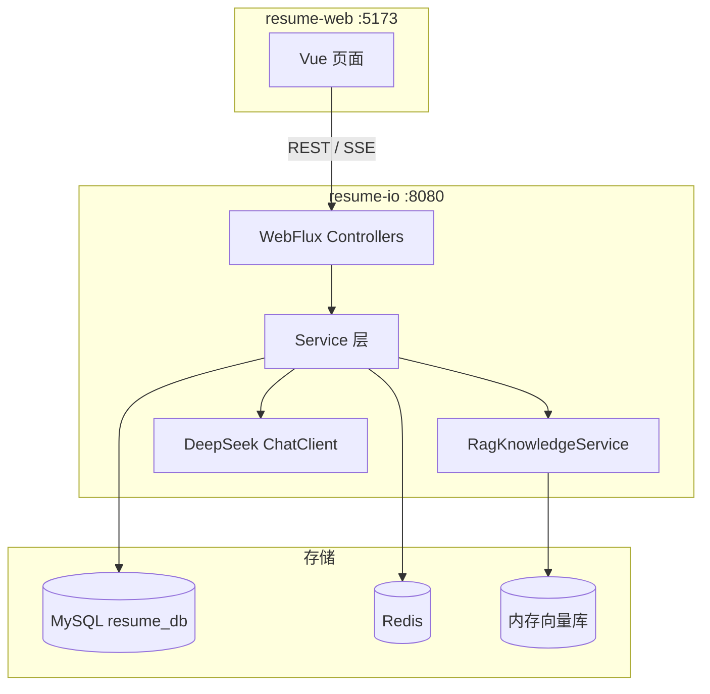

# Resume IO — AI 简历分析与模拟面试平台

基于 **Spring Boot + Vue 3** 的全栈项目，提供简历上传解析、AI 智能分析、RAG 增强对话、模拟面试等功能。

| 模块 | 目录 | 说明 |
|------|------|------|
| 后端 | [`resume-io/`](resume-io/) | Spring Boot 3.5 + WebFlux + JPA + JWT + Spring AI |
| 前端 | [`resume-web/`](resume-web/) | Vue 3 + Vite + Pinia + Element Plus |

---

## 功能概览

- **用户认证**：手机号 + 短信验证码注册、登录（JWT），注册即自动登录，演示账号开箱即用
- **简历分析**：上传 PDF/Word 等文档，AI 生成评分与优化建议
- **分析报告**：雷达图维度评分、优劣势与改进方向
- **模拟面试**：基于简历与报告生成面试题，支持流式 AI 反馈
- **AI 对话**：RAG 检索增强，结合简历与知识库回答问题
- **个人中心**：敏感资料（姓名、手机、身份证等）Redis 存储 + API 脱敏展示
- **知识库**：上传文档入库，供 RAG 检索引用

---

## 技术栈

### 后端（resume-io）

| 类别 | 技术 |
|------|------|
| 框架 | Spring Boot 3.5.16、Spring WebFlux |
| 持久化 | Spring Data JPA、MySQL 8 / H2（dev） |
| 安全 | Spring Security、JWT（jjwt） |
| AI | Spring AI、DeepSeek API |
| RAG | SimpleVectorStore、本地 Embedding |
| 缓存 | Redis（敏感资料存储） |
| 文档解析 | Apache Tika（spring-ai-tika-document-reader） |

### 前端（resume-web）

| 类别 | 技术 |
|------|------|
| 框架 | Vue 3、TypeScript、Vite 8 |
| 状态 / 路由 | Pinia、Vue Router 4 |
| UI | Element Plus、Tailwind CSS 4 |
| 图表 / 流式 | ECharts、fetch-event-source |

---

## 系统架构



---

## 项目结构

```
Java_projeck/
├── README.md                 # 本文件
├── docker-compose.yml        # ★ 全栈一键启动：MySQL + Redis + 后端 + 前端
├── .env.example              # 环境变量模板（可提交，不含真实密钥）
├── .env                      # 本机真实配置（含 API Key，已被 .gitignore 忽略）
├── resume-io/                # 后端
│   ├── src/main/java/        # Java 源码（含cursor生成的详细中文注释）
│   ├── src/main/resources/   # application.properties 等配置
│   ├── Dockerfile            # 后端镜像（Maven 构建 + JRE 运行）
│   ├── docker-compose.yml    # 只用 Docker 跑 MySQL + Redis 时用这个
│   ├── scripts/init-db.sql   # 首次启动建库脚本
│   ├── OPERATIONS.md         # 并发保护与持久化说明
│   ├── SECURITY.md           # 安全配置指南
│   └── RAG_EVALUATION.md     # RAG 评估说明
└── resume-web/               # 前端
    ├── Dockerfile            # 前端镜像（Node 构建 + Nginx 托管）
    ├── nginx.conf            # 容器内 Nginx：静态资源 + /api、/ws 反代
    └── src/
        ├── api/                # 接口封装
        ├── views/              # 页面组件
        ├── stores/             # Pinia 状态
        └── router/             # 路由与鉴权守卫
```

---

## 快速开始

### 环境要求

- **JDK 17**（`pom.xml` 的 `java.version` 就是 17；本机装了多个 JDK 时，`JAVA_HOME` 必须指向 17）
- **Maven 3.8+**
- **Node.js 20+**（前端）
- **Docker Desktop**（推荐：用它跑 MySQL / Redis，或直接全栈容器化）
- **DeepSeek API Key**（环境变量 `DEEPSEEK_API_KEY`，见下文「AI 配置与密钥管理」）

### 方式一：全栈 Docker 一键启动（最省事）

项目根目录的 `docker-compose.yml` 会同时拉起 MySQL、Redis、Spring Boot 后端和 Nginx 前端：

```powershell
cd D:\Project\Java_projeck
copy .env.example .env        # 首次：填好 DEEPSEEK_API_KEY
docker compose up -d --build  # 首次构建约 3~10 分钟
docker compose ps             # 等 4 个容器都 Up (healthy)
docker compose logs -f backend
```

打开 <http://localhost:5173>，用演示账号 `demo / 123456` 登录。

| 服务 | 宿主机地址 | 容器内地址 |
|------|-----------|-----------|
| 前端（Nginx） | <http://localhost:5173> | `frontend:80` |
| 后端（Spring Boot） | <http://localhost:8080> | `backend:8080` |
| MySQL 8 | `localhost:3307` | `mysql:3306` |
| Redis 7 | `localhost:6380` | `redis:6379` |

> 宿主机端口都在根目录 `.env` 里：`FRONTEND_PORT` / `BACKEND_PORT` / `MYSQL_HOST_PORT` / `REDIS_HOST_PORT`。
> 默认避开本机常被占用的 `3306`（MySQL80 服务）和 `6379`（WSL 里的 Redis）。
>
> 停止：`docker compose down`（保留数据卷）；`docker compose down -v`（⚠ 连数据库数据一起删）。

### 方式二：Docker 只跑 MySQL + Redis，前后端在本机跑（改代码即时生效，日常开发推荐）

**1. 启动基础设施**

```powershell
cd resume-io
docker compose up -d
docker compose ps        # mysql / redis 都要是 healthy
```

默认连接信息：

| 服务 | 地址 | 账号 |
|------|------|------|
| MySQL | `localhost:3307/resume_db` | `root` / `123456` |
| Redis | `localhost:6380` | 无密码 |

**2. 启动后端（注意端口要指向 3307 / 6380）**

```powershell
cd resume-io
$env:JAVA_HOME    = "D:\application\java\jdk-17"   # 必须是 JDK 17
$env:MYSQL_PORT   = "3307"
$env:REDIS_PORT   = "6380"
$env:DEEPSEEK_API_KEY = "<你的 Key>"
mvn spring-boot:run
```

- 后端地址：<http://localhost:8080>

**3. 启动前端**

```powershell
cd resume-web
npm install
npm run dev
```

- 前端地址：<http://localhost:5173>（`/api`、`/ws` 由 Vite 代理到 `127.0.0.1:8080`）

> ⚠ 如果不设 `MYSQL_PORT` / `REDIS_PORT`，应用会用默认的 `3306` / `6379`，
> 也就是本机原生 MySQL / WSL 里的 Redis，而不是 Docker 里那两个。
> 本机已有 MySQL 时也可以直接用本机库（不用 Docker），把 `MYSQL_PORT` 保持默认即可。

### 方式三：H2 内存库（完全不依赖 MySQL / Redis）

```powershell
cd resume-io
$env:JAVA_HOME = "D:\application\java\jdk-17"
mvn spring-boot:run "-Dspring-boot.run.profiles=dev"
```

- H2 控制台：<http://localhost:8080/h2-console>
- 该 profile 使用内存敏感资料存储，不需要 Redis

### 演示账号

首次启动且 `app.demo-data.enabled=true` 时，自动创建：

| 用户名 | 密码 |
|--------|------|
| `demo` | `123456` |

---

## 前端页面

| 路径 | 页面 | 说明 |
|------|------|------|
| `/` | 首页 | 简历上传与功能入口 |
| `/login` | 登录 / 注册 | 未登录可访问 |
| `/register` | 注册 | 手机号 + 6 位验证码注册，成功后自动登录 |
| `/profile` | 个人中心 | 查看 / 编辑敏感资料（需登录） |
| `/report/:id` | 分析报告 | 雷达图与 AI 建议 |
| `/interview` | 模拟面试 | 答题与流式反馈 |

---

## API 概览

所有接口前缀为 `/api`，除标注「公开」外均需 Header：`Authorization: Bearer <token>`。

### 认证 `/api/auth`

| 方法 | 路径 | 权限 | 说明 |
|------|------|------|------|
| POST | `/login` | 公开 | 登录，返回 JWT |
| POST | `/sms-code` | 公开 | 发送注册短信验证码（后端生成 6 位纯数字） |
| POST | `/register` | 公开 | 手机号注册（校验验证码通过后落库，成功即返回 JWT） |
| GET | `/me` | 登录 | 当前用户（脱敏） |
| GET | `/me/profile/full` | 登录 | 完整敏感资料 |
| PUT | `/me/profile` | 登录 | 更新敏感资料 |

#### 手机号注册流程

```
POST /api/auth/sms-code   {"phone":"13800001234"}
  → {"code":200,"data":{"phone":"13800001234","expiresInSeconds":300,
                        "resendAfterSeconds":60,"debugCode":"099167"}}
POST /api/auth/register   {"phone":"13800001234","code":"099167",
                           "password":"abc123","username":"可选，留空默认手机号"}
  → {"code":200,"data":{"token":"eyJ...","user":{...}}}     # 注册即登录
```

后端业务规则（`SmsCodeService`）：

| 规则 | 默认值 | 说明 |
|------|--------|------|
| 手机号格式 | `1[3-9]\d{9}` | 前后端各校验一次，后端为准；自动兼容 `+86`、空格、短横线 |
| 验证码 | 6 位纯数字 | `SecureRandom` 生成，含前导 0；存 Redis（无 Redis 时退化为内存） |
| 有效期 | 300 秒 | `app.sms.code-ttl-seconds` |
| 重发冷却 | 60 秒 | 同一手机号 60 秒内只能发一次，前端据此倒计时 |
| 错误次数 | 5 次 | 超限即作废验证码，需重新获取；计数用 Redis `INCR` 保证并发安全 |
| 一次性使用 | — | 校验通过立即删除验证码，防重放 |
| 唯一性 | — | 手机号、用户名都唯一，重复注册会给出明确提示 |

> **验证码怎么拿到？** 当前未接入真实短信网关（`LoggingSmsSender` 只打日志）：
> ① 响应里的 `debugCode` 字段（`app.sms.debug-return-code=true` 时才有，注册页会直接显示）；
> ② 后端日志：`【模拟短信】138****1234 的验证码为 099167 ...`。
> 接入阿里云/腾讯云短信只需新增一个 `SmsSender` 实现类，业务代码不用改。


### 简历 `/api/resume`

| 方法 | 路径 | 说明 |
|------|------|------|
| POST | `/upload` | 上传简历并触发 AI 分析 |

### 报告 `/api/report`

| 方法 | 路径 | 说明 |
|------|------|------|
| GET | `/{id}` | 获取分析报告 |

### 面试 `/api/interview`

| 方法 | 路径 | 说明 |
|------|------|------|
| POST | `/start` | 开始模拟面试 |
| POST | `/answer` | 提交答案 |
| POST | `/stream` | 流式 AI 点评（SSE） |

### 对话 `/api/chat`

| 方法 | 路径 | 说明 |
|------|------|------|
| GET | `/stream` | RAG 增强流式对话（SSE） |
| POST | `/sync` | 同步对话 |

### 知识库 `/api/knowledge`

| 方法 | 路径 | 说明 |
|------|------|------|
| POST | `/upload` | 上传知识文档并向量化入库 |

---

## 数据库表

JPA 自动建表（`spring.jpa.hibernate.ddl-auto=update`）：

| 表名 | 说明 |
|------|------|
| `users` | 用户账号（`username` 唯一、`phone` 唯一，手机号注册时写入） |
| `resumes` | 简历原文 |
| `analysis_reports` | AI 分析报告（JSON） |
| `interview_sessions` | 面试会话 |
| `interview_questions` | 面试题目 |

敏感资料（姓名、身份证、地址等）存储在 **Redis**，Key 格式：`user:sensitive:{userId}`。
手机号是注册主身份，同时存在于 `users.phone`（唯一索引）和敏感资料里（后者供个人中心脱敏展示）。

短信验证码临时存储在 Redis，Key 形如 `sms:code:register:{phone}`、
`sms:attempts:register:{phone}`、`sms:cooldown:register:{phone}`，均带 TTL 自动过期。

---

## 配置说明

主要配置位于 `resume-io/src/main/resources/application.properties`：

| 配置项 | 默认值 | 说明 |
|--------|--------|------|
| `server.port` | `8080` | 后端端口 |
| `MYSQL_*` | `localhost:3306/resume_db` | MySQL 连接 |
| `REDIS_HOST` | `localhost` | Redis 地址 |
| `DEEPSEEK_API_KEY` | — | DeepSeek API Key（兼容旧名 `DASHSCOPE_API_KEY`） |
| `DEEPSEEK_MODEL` | `deepseek-flash` | 模型名（可选 `deepseek-v4-pro`） |
| `DEEPSEEK_BASE_URL` | `https://api.deepseek.com/` | 模型服务地址 |
| `app.rag.top-k` | `5` | RAG 检索条数 |
| `app.sensitive.storage` | `redis` | 敏感资料存储（`memory` 用于 dev/test） |
| `app.demo-data.enabled` | `true` | 是否创建演示账号 |
| `app.sms.storage` | `redis` | 验证码存储（`memory` 用于 dev/test） |
| `app.sms.code-ttl-seconds` | `300` | 验证码有效期（秒） |
| `app.sms.resend-interval-seconds` | `60` | 重新发送冷却（秒） |
| `app.sms.max-verify-attempts` | `5` | 验证码最大错误次数 |
| `app.sms.debug-return-code` | `true` | 是否把验证码随响应回传（生产改 `false`） |

开发配置见 `application-dev.properties`（H2 + 内存敏感存储 + 禁用 Redis 自动配置）。

---

## AI 配置与密钥管理

### 密钥怎么给

优先级：`DEEPSEEK_API_KEY` > `DASHSCOPE_API_KEY`（旧变量名，仅为兼容历史配置保留）。
三种方式任选：

| 场景 | 做法 |
|------|------|
| 全栈 Docker | 写进根目录 `.env`（已 gitignore），`docker compose up -d backend` |
| 本机运行后端 | `$env:DEEPSEEK_API_KEY = "sk-..."` 后 `mvn spring-boot:run` |
| 临时验证 | `$env:DEEPSEEK_API_KEY="..."` 只对当前终端生效 |

### 封装方式（读代码只看这一个地方）

| 关注点 | 落点 |
|--------|------|
| 唯一装配点 | `config/AiConfig.java`：把 `ChatClient.Builder` 构建成全局唯一的 `ChatClient` Bean，`ChatService` / `ResumeAnalysisService` 统一注入它，不再各自 `builder.build()` |
| 配置项 | `application.properties` 的 `spring.ai.deepseek.*`，全部支持环境变量覆盖 |
| 密钥脱敏 | `util/SecretMask.java`，启动日志只打印 `sk-1234****cdef` 这种形式 |
| 启动自检 | `AiConfig#aiConfigReporter`：启动时打印 `base-url` / `model` / 脱敏后的 key；没配 key 会给出明确 WARN，而不是等到调用时才 401 |

启动日志示例：

```
AI 配置自检：base-url=https://api.deepseek.com/ model=deepseek-flash api-key=sk-1234****cdef
```

### 密钥不进仓库的约定

- `.env` 已加入 `.gitignore`，仓库里只保留 `.env.example`（占位符）。
- 源码 / Dockerfile / `docker-compose.yml` 里都不出现明文 Key，只做 `${DEEPSEEK_API_KEY}` 变量引用。
- 日志、异常提示、启动横幅统一走 `SecretMask`，不打印明文。
- 轮换密钥：改 `.env`（或环境变量）→ 重启后端即可，无需改代码。

---

## 运行测试

```powershell
cd resume-io
mvn test
```

包含认证、RAG、报告持久化、面试并发等集成测试。

---

## 常见问题

### MySQL 连接失败 / `Unable to determine Dialect without JDBC metadata`

```
Communications link failure
Unable to determine Dialect without JDBC metadata
```

后面这条并不是 Hibernate 配置问题，而是**根本没连上数据库**时 Hibernate 兜底报的错。依次检查：

1. `docker compose ps`：mysql 是否为 `healthy`（后端在 MySQL 起来之前启动就会崩，容器的
   `depends_on: condition: service_healthy` 就是为了避免这一点）
2. 端口有没有指错：Docker 里的 MySQL 映射在宿主机 **3307**，不是 3306
   （`$env:MYSQL_PORT="3307"`）
3. 想完全跳过 MySQL：`mvn spring-boot:run "-Dspring-boot.run.profiles=dev"` 用 H2 内存库

### Docker 构建卡在 `Pulling` / 拉镜像超时

Docker Hub 直连常被墙。把基础镜像换成可用镜像源（本项目实测 `docker.1panel.live` 可用），
写在根目录 `.env` 里即可，`Dockerfile` / compose 会自动使用：

```dotenv
MAVEN_IMAGE=docker.1panel.live/library/maven:3.9-eclipse-temurin-17
JRE_IMAGE=docker.1panel.live/library/eclipse-temurin:17-jre-jammy
NODE_IMAGE=docker.1panel.live/library/node:20-alpine
NGINX_IMAGE=docker.1panel.live/library/nginx:1.27-alpine
MYSQL_IMAGE=docker.1panel.live/library/mysql:8.0
REDIS_IMAGE=docker.1panel.live/library/redis:7-alpine
```

### 宿主机 3306 / 6379 被占用

本机 MySQL80 服务占 3306，WSL 里的 Redis 占 6379，所以 Docker 默认映射到
**3307 / 6380**。要改端口就改根目录 `.env` 的 `MYSQL_HOST_PORT` / `REDIS_HOST_PORT`。

### 前端请求 502（`Parse Error: Data after 'Connection: close'`）

Vite 代理把客户端的 `Expect: 100-continue` 转给了 Netty 后端，Node 的 HTTP 解析器会报错。
`vite.config.ts` 里已用中间件剥离该请求头，无需再处理。
如果仍出现，确认走的是 `http://localhost:5173`（代理目标是 `127.0.0.1:8080`）。

### `java` 命令没有输出、直接退出

Windows 上 `C:\Program Files\Common Files\Oracle\Java\javapath\java.exe` 是 Oracle 安装器留下的
损坏入口（执行会以 `0xC0000409` 直接崩溃），即使 `JAVA_HOME` 正常也无法运行 `java -jar`。
解决办法：用真实 JDK 路径，或把 `D:\application\java\jdk-17\bin` 放到 PATH 里
（`cargo`/`mvn` 之类都靠 `JAVA_HOME`，所以 Maven 反而是正常的）。

### 8080 / 5173 端口被占用

先停掉旧进程（`Get-NetTCPConnection -LocalPort 8080` 找到 PID 再 `Stop-Process`），
或改 `.env` 的 `BACKEND_PORT` / `FRONTEND_PORT`（本机直接跑时改 `server.port` / vite 的 `server.port`）。

### AI 功能报错（401 / Model Not Exist）

```
401 Unauthorized from POST https://api.deepseek.com/chat/completions
```

说明 `DEEPSEEK_API_KEY` 不是有效的 DeepSeek Key（失效、或填的是别的平台的 Key）。
到 <https://platform.deepseek.com/> 重新申请后写进 `.env`（Docker）或环境变量（本机运行），
重启后端即可。可以先用下面这条命令验证 Key：

```powershell
curl.exe -s "https://api.deepseek.com/models" -H "Authorization: Bearer <你的Key>"
```

如果报 `Model Not Exist`，检查模型名。当前可用模型（可用
`curl.exe -s https://api.deepseek.com/models -H "Authorization: Bearer <Key>"` 查）：

| 模型名 | 说明 |
|--------|------|
| `deepseek-flash` | 通用对话，快，默认 |
| `deepseek-v4-pro` | 能力更强，更慢 |

切换：`$env:DEEPSEEK_MODEL="deepseek-v4-pro"`（Docker 环境改 `.env` 后
`docker compose up -d backend`）。

### RAG 向量数据重启后丢失

当前使用内存向量库（`SimpleVectorStore`），重启后需重新入库；面试开始时会自动 re-index 简历。

---

## 相关文档

| 文档 | 说明 |
|------|------|
| [resume-io/OPERATIONS.md](resume-io/OPERATIONS.md) | 并发保护、JPA 实体化、运维说明 |
| [resume-io/SECURITY.md](resume-io/SECURITY.md) | JWT、CORS、生产环境安全 checklist |
| [resume-io/RAG_EVALUATION.md](resume-io/RAG_EVALUATION.md) | RAG 流程与评估 |

---

## License

本项目仅供学习与研究使用。
